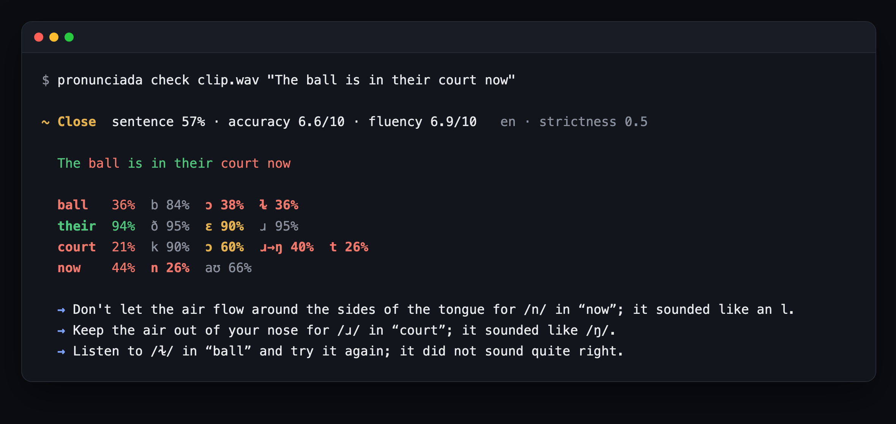
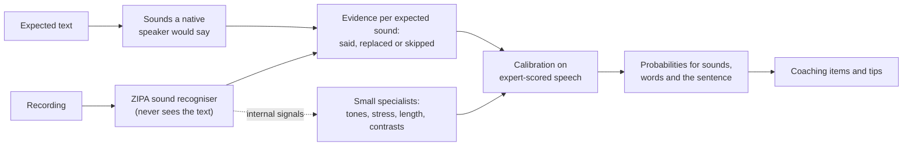

<p align="center">
  
</p>

<p align="center">
  <b>Pronunciation scoring that runs on the device.</b><br>
  Ten languages. Every sound, word and sentence, with tones, stress and coaching tips. Open source.
</p>

<p align="center">
  <a href="https://github.com/moglearn/pronunciada/actions/workflows/ci.yml"></a>
  <a href="https://pypi.org/project/pronunciada/"></a>
  
  <a href="LICENSE"></a>
  <a href="results/SCOREBOARD.md"></a>
</p>

<p align="center">
  
</p>

Pronunciada takes a recording and the sentence the speaker was reading, and returns how likely a
teacher would accept each **sound**, each **word** and the whole **sentence**. It also says what
went wrong in terms an app can show a learner: the tone that was heard, the stress that was
missed, the vowel that was too short, the sound that came out as another one.

It runs on a laptop CPU in about 50 ms for a short sentence, with numpy and ONNX Runtime. No
audio leaves the machine and there is no fee per request.

```bash
pip install pronunciada
pronunciada check clip.wav "The ball is in their court now" --lang en
```

## How it compares with Azure

Microsoft Azure Pronunciation Assessment is the service most language apps call. Both systems
were given the same held-out recordings and prompts. Higher is better in every row.

| Test | What it measures | Pronunciada | Azure |
|---|---|---|---|
| English learners, sounds | agreement with expert scores for each sound | **0.69** | 0.54 |
| English learners, words | agreement with expert scores for each word | 0.61 | 0.59 |
| English learners, sentence accuracy | agreement with expert sentence scores | **0.75** | 0.67 |
| English learners, fluency | agreement with expert fluency scores | 0.78 | 0.71 |
| English learners, intonation | agreement with expert prosody scores | 0.77 | **0.83** |
| English: which sound was wrong | flagged sounds that experts also marked, at equal coverage | **66%** | 44% |
| English learners never seen in training | finding the sounds experts marked wrong (L2-ARCTIC, six native languages) | **0.71** | 0.63 |
| Mandarin learners, wrong words | finding the words teachers marked wrong | **0.79** | 0.70 |
| Mandarin learners, tones | finding the tone mistakes teachers marked | **0.78** | 0.68 |

Bold marks a statistically significant lead. Across all 84 comparisons we ran, Pronunciada is
ahead in 60 (40 significantly) and behind in 24 (7 significantly). The full table, with
confidence intervals, the cases where Azure wins, and the commands that regenerate every number,
is in **[results/SCOREBOARD.md](results/SCOREBOARD.md)**.

Two things to know before quoting these:

- Expert-marked learner recordings are public only for English and Mandarin. For the other eight
  languages the comparison uses native recordings with one word of the prompt changed, and
  recordings that volunteer reviewers accepted or rejected.
- Azure was not tuned on any of this data. Parts of Pronunciada were tuned on the training
  halves of the same datasets; every number here is from the held-out half. L2-ARCTIC and EpaDB
  were used for measurement only, so nothing shipped has seen them.

## What you get

| | Sounds, words, sentences | Tones | Word stress | Length | Hard contrasts | Checked on learners |
|---|:-:|:-:|:-:|:-:|---|:-:|
| English | ✓ | | ✓ | | th-sounds | ✓ |
| Mandarin (简体 / 繁體) | ✓ | ✓ | | | aspiration | ✓ |
| Japanese | ✓ | | | ✓ | voicing | |
| Spanish | ✓ | | ✓ | | | |
| French | ✓ | | | | | |
| German | ✓ | | ✓ | | voicing | |
| Italian | ✓ | | ✓ | | | |
| Portuguese | ✓ | | ✓ | | | |
| Russian | ✓ | | ✓ | | soft and hard consonants | |
| Korean | ✓ | | | | aspiration, tense consonants | |

- **Probabilities, not raw scores.** Every result is a calibrated probability between 0 and 1,
  and one `strictness` setting moves all of them from "understandable" to "native-like".
- **Coaching output.** For each flagged sound: what was expected, what it sounded like when that
  can be named reliably, which mouth feature differed (voicing, lip rounding, tongue position),
  and a short tip with a stable key so your app can reword or translate it.
- **Reading slips.** Skipped words, extra speech, long pauses and rushing through punctuation.
- **Recording check.** A warning when the audio is clipped, too noisy, too quiet or mostly
  silence, so a bad microphone is not scored as bad pronunciation.

## Use it

### Python

```python
import pronunciada

result = pronunciada.score("clip.wav", "The ball is in their court now", lang="en")

result.prob                               # 0.55, probability the sentence would be accepted
for word in result.words:
    print(word.text, round(word.prob, 2)) # COURT 0.22
    for sound in word.phones:
        print("  ", sound.ipa, round(sound.prob, 2), sound.heard)

for item in result.coaching():            # most important first
    print(item["kind"], item["word"], item["expected_ipa"], item["heard_ipa"], item["diff_keys"])
```

For repeated calls keep a scorer: `scorer = pronunciada.Scorer("zh")`, then `scorer.score(...)`.
`scorer.rescore(result, strictness=0.9)` re-grades without running the model again.
The coaching schema is documented in [docs/COACHING.md](docs/COACHING.md).

### Command line

```bash
pronunciada check clip.wav "我家有四口人" --lang zh          # the report shown above
pronunciada check clip.wav "Buenos días" --lang es --json   # full result as JSON
pronunciada langs                                           # languages and what each needs
```

### Already parsing Azure's JSON?

```python
from pronunciada.compat.azure import to_azure

payload = to_azure(pronunciada.score("clip.wav", "Good morning", lang="en"))
payload["NBest"][0]["PronunciationAssessment"]["AccuracyScore"]
```

`pronunciada serve --azure-compat` runs a local server that answers Azure's short-audio REST
request in the same shape, so an existing client only needs its base URL changed. The format
matches; the numbers are Pronunciada's own, so thresholds need to be chosen again.
Field-by-field notes: [docs/AZURE_COMPAT.md](docs/AZURE_COMPAT.md).

### For AI agents

```bash
pip install "pronunciada[mcp]"
pronunciada mcp          # Model Context Protocol server over stdio
```

This exposes `assess_pronunciation(audio_path, reference_text, language)` to Claude, Cursor and
other MCP clients. Setup: [docs/MCP.md](docs/MCP.md).

### Install options

```bash
pip install pronunciada              # English, Spanish, French, German, Italian, Portuguese, Russian, Korean
pip install "pronunciada[zh]"        # + Mandarin text handling
pip install "pronunciada[ja]"        # + Japanese text handling (about 300 MB installed)
pip install "pronunciada[all]"       # everything
```

The speech model is downloaded on first use into `~/.cache/pronunciada` (248 MB, or 67 MB with
`precision="int8"`). Runtime dependencies are numpy, scipy, onnxruntime, kaldi-native-fbank and
soundfile. There is no PyTorch at runtime.

## How it works



1. **Text to sounds.** Dictionaries and rules for each language turn the sentence into the
   sounds a native speaker would produce, including tone changes in Mandarin and linking in French.
2. **An open sound recogniser.** [ZIPA](https://github.com/lingjzhu/zipa) turns the audio into
   probabilities over the sounds of the world's languages. A small adapter per language corrects
   its habits. It never sees the expected text, so it cannot be led by it.
3. **Evidence without forced alignment.** For each expected sound the scorer weighs "it was
   said" against "something else was said" and "it was skipped".
4. **Calibration.** Small models trained on speech that experts scored turn the evidence into
   probabilities for sounds, words and sentences.
5. **Small specialists.** The recogniser's output drops tone, stress and length. Tiny models
   read its internal layers to recover them. Everything trained for this project adds about
   10 MB to the package.

More detail: [docs/DESIGN.md](docs/DESIGN.md).

## What it does not do yet

- **Proof on real learners exists for English and Mandarin only.** Real mistakes are much harder
  to catch than planted ones, so treat the other eight languages as less proven.
- **English sentence intonation trails Azure** (0.77 against 0.83). The models that close that
  gap are several times too large for a phone.
- **Slightly more false alarms on native speakers than Azure** in English, Japanese, Spanish
  and Portuguese: about 3% of a native speaker's words fall below the default cut-off, against
  about 2%.
- **Some contrasts are still missed:** Italian double consonants, Portuguese nasal vowels.
  Japanese pitch accent is not scored.
- **It needs the expected text.** For free speech, pass in a transcript from your own recogniser.
- **It is a Python package.** It runs on laptops and servers. iOS, Android and browser builds
  are not written yet.

The complete list, with numbers, is in the [scoreboard](results/SCOREBOARD.md) and
[results/contrast_audit.md](results/contrast_audit.md).

## Reproducing the benchmarks

Every benchmark is a command. The datasets are public and Azure's answers are cached locally, so
nothing is sent anywhere when you re-run them.

```bash
pip install -e ".[all,bench]"
python -m bench.eval_english      # English learners against Azure
python -m bench.eval_languages    # ten languages, native speech and changed-word tests
python -m bench.scoreboard        # rebuilds results/SCOREBOARD.md
```

Data download, the remaining commands and how long they take:
[docs/benchmarks_data.md](docs/benchmarks_data.md).

## How this was built

Pronunciada started at [Moglearn](https://moglearn.com), a language-learning app that needed
pronunciation feedback without sending learners' voices to a paid cloud service.

No large model was trained for it. The approach was to take an open speech model, add classical
scoring methods and each language's sound rules, and improve the result through measured rounds
against the commercial service, with an AI coding agent doing the implementation and a person
setting the direction. Each round had to state its bar in advance, be selected on development
data, and take one look at the held-out data. Eighteen rounds are written up in
[results/](results/), including the ones that failed: Japanese pitch accent, a general
"second opinion" for sounds, synthetic speech for training, and several outside models that did
not earn their size.

## Roadmap

- Browser (WebAssembly) and mobile builds
- Expert-marked learner data for more languages
- Plugins for real-time voice-agent frameworks
- Italian and Portuguese contrast detectors

## Licence and credits

Code is Apache-2.0. The speech model, [ZIPA](https://github.com/lingjzhu/zipa) by Zhu et al.,
is CC BY 4.0 and is downloaded on first use. The Italian, Portuguese and Russian pronunciation
files derive from Wiktionary and stay under CC BY-SA. Every data file, the dataset it was fitted
on and its licence are listed in [docs/LICENSING.md](docs/LICENSING.md) and [NOTICE](NOTICE).

Thanks to the people behind ZIPA, speechocean762, OMPAL, FLEURS, Common Voice, L2-ARCTIC, EpaDB
and AISHELL, whose public work made the measurements possible.

"Azure" is a trademark of Microsoft. This project is not affiliated with or endorsed by Microsoft.

If you use Pronunciada in research, see [CITATION.cff](CITATION.cff).
